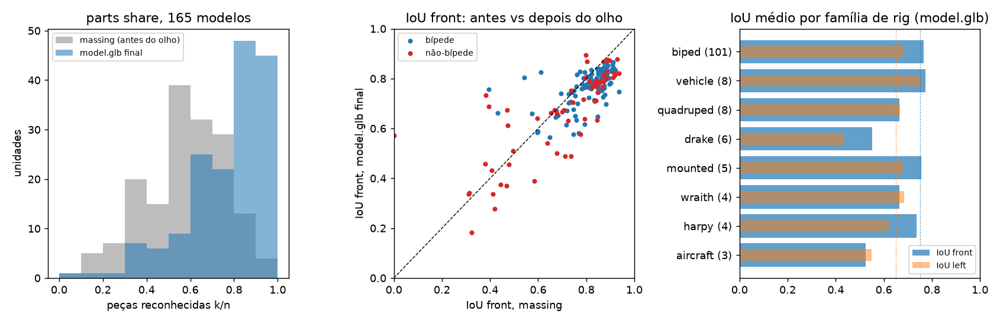

# 04 — Resultados e descobertas (2026-11-07)

Síntese do que o pipeline mede hoje, em largura, e do que isso prova. Os números desta secção foram calculados do disco em 2026-11-07
(`results-roster-v6.csv`, uma linha por modelo final do `roster-v6`; figura `figuras/resultados-roster-v6.png`). A leitura hostil que
levou a esta secção está em `REVIEW-2026-11-07.md`.

## Resumo

Em 18 dias o pipeline passou de 7 unidades (baseline `hard-v1`, 1/7 PASS) a **165 modelos** rigados de ≈ 690 tris, gerados a partir de
160 cartões de design sem ninguém tocar num modelo, em ≈ 26 h de relógio (estimativa), 105,9 h de máquina e US$ 24,3 de imagem.
Medido nas 165 com a mesma régua (`eye_stage.measure`, concept de-inked): o estágio do olho (artista VLM que vê o render, 3 rondas) sobe
as peças reconhecidas de .57 para .78 (+.21, 136/165 sobem) e **baixa** a silhueta (IoU front .765 → .710, 140/165 descem); o passo
determinístico seguinte (união por osso + molde SAM2 + juntas) devolve +.016 de front em 121/165. O GLB final fica em parts .77, IoU
front .73 / left .66 / back .71, e passa o gate do baseline (front ≥ .75 e left ≥ .65) em **78/165** — a mesma taxa do baseline (3/7),
agora em 165. O gate "honesto" da Leva 12 (spill ≤ .03) fecha em **0/165**, como fechava 0/36 vistas em 2026-10-30: "PASS 0" é
propriedade do gate. O pipeline é de bípedes (101: front .77, gate 52/101); os 64 não-bípedes em 24 famílias de rig ficam em .66 e
concentram os 12 piores. 61 unidades (38 %) foram entregues sem olho por uma regra de validação que parava o estágio em silêncio, e
refeitas. O artista Opus é 26 % do tempo do estágio de modelo; o custo que escala voltou a ser o pré-olho. Não há avaliação humana,
baseline externo, repetição nem ablação em largura: o resultado é engenharia de largura demonstrada, não qualidade demonstrada.

## 1. O que foi medido nas 165

Três estados do mesmo modelo, mesma régua (`eye_stage.measure`: `silhouette.py --gate parts` sobre o render ortográfico e o sheet
aprovado de-inked; parts k/n = peças do `parts.json` cuja zona de cor/cobertura/lado bate no render):

| medida (média / mediana) | massing (`base`, antes do olho) | ronda final do olho (peças) | `model.glb` final |
|---|---|---|---|
| parts k/n | .571 / .586 | .779 / .828 | **.770 / .829** |
| IoU front | .765 / .821 | .710 / .750 | **.726 / .770** |
| IoU left | .678 / .733 | .650 / .687 | **.660 / .696** |
| IoU back | .750 / .815 | .694 / .741 | **.709 / .761** |
| IoU rts (n = 117–118; 47 unidades sem painel rts medido) | .728 / .736 | .670 / .692 | **.679 / .697** |
| front ≥ .75 e left ≥ .65 (gate do baseline) | 84/165 | 69/165 | **78/165** |
| spill ≤ .03 em front e left (gate da Leva 12, stage 1) | 0/165 (stage 1 FAIL 164/164) | — | **0/165** |



Pares dentro da mesma unidade:

| passo | parts | IoU front | IoU left | IoU back | IoU rts |
|---|---|---|---|---|---|
| massing → ronda final (olho) | **+.208** (136↑ 20↓; 110 acima do ruído .12) | −.055 (25↑ 140↓) | −.028 (54↑ 111↓) | −.057 (22↑ 143↓) | −.060 (20↑ 97↓) |
| ronda final → GLB (união + molde + juntas) | −.009 (53↑ 73↓) | **+.016** (121↑ 42↓) | +.010 (105↑ 59↓) | +.015 (120↑ 44↓) | +.009 (81↑ 36↓) |
| massing → GLB final | +.199 (135↑ 22↓) | −.039 (34↑ 131↓) | −.018 (60↑ 105↓) | −.041 (31↑ 134↓) | −.050 (21↑ 96↓) |

Por família de rig (GLB final): bípedes n = 101, front .765 / left .686 / parts .81, gate 52/101; não-bípedes n = 64 (24 famílias, 20 com n ≤ 8),
.664 / .620 / .70, gate 26/64. Por raça, gate do baseline: Mech 12/16, Pandaren 8/9, Orc 8/15, Desert 7/12, Human 7/13, Nature 6/13, Chaos 5/10,
Corrupted 5/11, Elemental 5/13, Undead 5/11, Northern 4/11, Elf 3/9, Nightelf 2/11, Naga 1/11.

Tempo e custo (`status.json`, `eye/summary.json`): estágio de modelo mediana 2 239 s (1 252–4 475), soma 105,9 h; dentro dele o olho 778 s
(artista Opus 576, revisor por vista Sonnet 55, medida 41); os ≈ 1 460 s restantes (massing, fit, SAM2, TripoSplat ≈ 350 s) não estão
itemizados em nenhum log. `llm_calls` mediana 27 (13–34); reenvios por regra de junção 0: 15, 1: 54, 2: 41, 3: 38, 4: 17. Custo de imagem
US$ 24,33 (40 unidades pagaram `sheets`; as outras já tinham sheet das rondas da ficha 17). Opus/Sonnet são quota de sessão, sem US$.

## 2. Descobertas

| # | descoberta | evidência | tamanho do efeito |
|---|---|---|---|
| D1 | A cadeia prompt → sheet → parts → modelo corre em largura sem intervenção por unidade | `status.json`: 164/166 linhas chegam a `model`; 165 GLBs; 9 classes de falha, todas do pipeline (ficha 19) | 7 → 165 unidades; 2 239 s e US$ 0,15 de imagem por unidade |
| D2 | O laço VLM que vê (olho) troca silhueta por peças | 165 pares massing → ronda final, mesma régua | parts +.21 (136↑), IoU front −.055 (140↓); 35 % do tempo do estágio |
| D3 | O passo determinístico pós-olho recupera parte da silhueta | 165 pares ronda final → GLB | front +.016 (121↑ 42↓), back +.015, left +.010; pequeno, consistente, confundido (união, molde e juntas entram juntos) |
| D4 | O gate decide a taxa de PASS, não o modelo | stage 1 (spill ≤ .03) 0/165 desde a Leva 12 (0/36 vistas, ficha 11); gate do baseline 78/165 no GLB | a mesma produção dá 0 % ou 47 % conforme a régua |
| D5 | O pipeline é de bípedes | bípedes gate 52/101, parts .81; não-bípedes 26/64, parts .70; os 12 piores em parts (ray .08, wyrm .15, spider_high .25, drake ≈ .40) são todos não-bípedes | ≈ −.10 de IoU front e −.11 de parts para 39 % do roster |
| D6 | Uma regra de validação estrita é uma falha silenciosa de 38 % | 61/160 com `final_round None`; o `model.glb` entregue era o `eye/input.glb` (61/61) e a tabela dizia `done`; rerun soft: parts .587 → .807 (52↑ 6↓) | sem o rerun, 38 % do roster era massing sem olho |
| D7 | Mais rondas de Opus saturam | `best_round` escolhe a ronda 0 em 36/165 e a 1 em 33 (42 %) apesar de 2–3 rondas seguintes | ≈ 40 % das chamadas do artista não melhoram a ronda escolhida |
| D8 | O custo que escala voltou a ser o pré-olho | artista 576 s de 2 239 s (26 %); no `v18-r0` era 92 % (01-tese) | os moldes neurais e o massing custam mais do que o VLM |
| D9 | O sheet é decidido por um humano e é o juiz de tudo | ficha 17: 20 rondas, 130 → 0 rejeitadas, 266 redesenhos; horas não medidas | "one-shot" vale para o estágio de modelo, não para a cadeia |

## 3. Resultados negativos (também são resultados)

- **PASS 0/165** no gate declarado em `01-tese.md` (stage 1). A métrica principal do paper não se moveu desde a Leva 12.
- **O olho baixa o IoU** em 140/165 unidades (front −.055). A métrica de silhueta e a de peças puxam em sentidos opostos.
- **As alavancas da ficha 18 não estão demonstradas**: n = 2, deltas do molde ≤ .05 (ruído declarado .12), sem braço de controlo no roster-v6.
  A única evidência em largura é D3 (+.016, confundida).
- **O revisor por vista** (Sonnet) sobe a própria nota (front 4.3 → 6.4 em 165) enquanto o IoU medido desce: a nota não é medida independente.
- **Os papers de reconstrução de forma** não moveram o juiz (03-balanço: 0 de 14 em default); os de medida/malha ficaram (12).
- **Juiz LLM**: não transitivo (ficha 13), ignorado pelo autor quando discorda (Leva 19), nunca calibrado contra humanos.
- **62/165 unidades a 699–700 tris**: o orçamento é preenchido por construção; "≈ 690 tris" é tecto, não resultado.
- **47 unidades sem rts medido**; textura, team colour, legibilidade a 32 px e fiação no engine (baseline §7) continuam abertos.

## 4. Limitações

1. Uma trajectória por unidade (n = 1); ruído .12 medido no baseline e nunca re-medido com a receita actual.
2. `parts k/n` depende de uma segmentação do sheet feita por VLM (`parts.json`); IoU mede envelope. Nenhum dos dois mede "parece WC3".
3. A régua mudou a meio (de-ink em 2026-11-05; `parts.json` regenerado no roster-v6): comparações com `roster-v5`/`v1` são só indicativas
   (v5 → v6, 24 unidades: parts .52 → .86, 23↑; IoU front do massing .84 → .77, 22↓).
4. O batch foi corrigido 9 vezes a meio com `--resume`: unidades antes e depois correram código diferente.
5. Custos: só imagem em US$; Opus/Sonnet em quota; horas do autor na revisão dos sheets não contadas; "26 h de relógio" é estimativa.
6. Conjunto de teste inexistente: todas as 160 unidades tiveram o sheet revisto pelo autor; as 6 unidades de desenvolvimento estão no roster.
7. Segundo caso de estudo (prometido em `01-tese.md`) não existe.

## 5. Ameaças à validade

- **Construto**: PASS/IoU/parts são proxies escolhidos pelo pipeline; o juiz de semelhança é um LLM a avaliar o que outro LLM fez.
- **Interna**: sem controlo nem ablação em largura; várias alavancas entraram juntas no default; a régua mudou durante o estudo.
- **Externa**: 1 jogo, 1 estilo, 14 raças inventadas; 61 % bípedes; gateway único (ppq) e modelos que mudam.
- **Conclusão estatística**: n = 1 por unidade; efeitos abaixo do ruído declarados como ganhos nas fichas 18 e 03-balanço (agora rotulados).

## 6. Trabalho futuro

1. **Avaliação humana**: ≥ 3 avaliadores, ≈ 30 unidades estratificadas por rig, pares (GLB vs WC3 original, GLB vs concept); calibrar o juiz LLM.
2. **Baseline externo** nas mesmas unidades: TRELLIS (aprovado como baseline do paper) e uma API comercial (Meshy/Tripo); mesmas métricas.
3. **Ablação em largura** com a receita congelada: molde off/on, juntas, revisor por vista, cápsula vs caixa, de-ink; ≥ 20 unidades; 3 repetições.
4. **Gate calibrado**: usar o gate do baseline como stage 1 (ou mostrar que o gate honesto correlaciona com humanos) e separar bípedes de não-bípedes.
5. **Não-bípedes**: famílias de rig com n ≤ 8 têm de ser tratadas como projecto próprio (drake, aircraft, spider, ray, wyrm).
6. **Pré-olho**: itemizar os ≈ 1 460 s; TripoSplat (≈ 350 s, ganho medido só em n02S) é o primeiro candidato a sair.
7. **Texturas pós-GLB** (ficha 20, nada medido): atlas de paleta + AO em 3 degraus e bakes estilizados sem IA primeiro (custo 0, segundos por
   modelo), A/B em hfoo, n005 e 1 edifício renderizados pelo pixel shader a 450 px; inpaint mascarado (nano-banana/SD) só para olhos, rebites,
   emblema; Meshy/Tripo 1 teste de US$ 0,20 só para calibrar. Regras: ≤ 128 px por modelo, nearest sem mip, paleta 16–32 cores por raça.
8. **Segundo caso de estudo** com outro perfil de estilo, como a tese prometia.

## 7. Reprodução

Scripts em `ferramentas/roster-v6/` (os caminhos `S`/`OUT` no topo de cada um apontam para o scratchpad da sessão de 2026-11-07; ajustar):

```bash
# IoU/parts do GLB final das 165 (12 s por unidade, 3 em paralelo; python3.14 com o venv do pipeline)
cd castle_fight && python3.14 ferramentas/roster-v6/measure_final.py 3    # -> final-measure/<id>.json
python3 ferramentas/roster-v6/compute.py                                   # massing / ronda final / v6e / v5 / por raça e rig -> results-roster-v6.csv
python3 ferramentas/roster-v6/compute2.py                                  # 61 do rerun, notas do revisor, tempo do artista, best_round
<venv com matplotlib>/python ferramentas/roster-v6/compute3.py            # junta o GLB final ao CSV, imprime as tabelas desta secção, desenha a figura
```

Fontes: `runs/roster/roster-v6/{final-models.json,status.json}`, `runs/draft/<id>/<run>/{eye/summary.json,silhouette.json}`.
